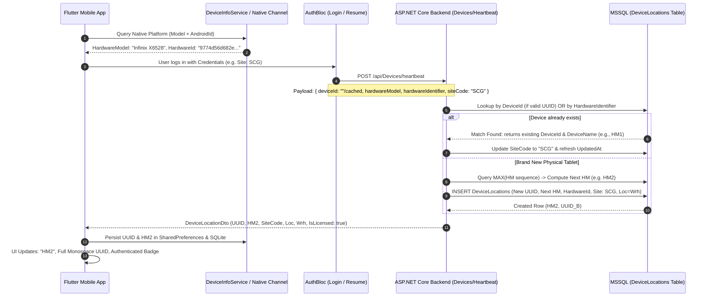

# Architectural Plan: Automated Tablet Fleet Provisioning & Device Identity

## 1. Executive Summary & Objective

This plan addresses device identification, automatic numbering, site tenancy, and fallback removal:
1. **Dynamic Site Code on Login**: Device site alignment dynamically follows the authenticated user's `SiteCode` claim, while `LocationCode` and `WarehouseCode` are maintained identically by administrative configuration.
2. **Elimination of Fallbacks (Gap 3)**: Remove the hardcoded `'HM1'` fallback from `DeviceInfoService` and the UI to ensure the displayed name strictly reflects truth at all times.
3. **Hardware Model Accuracy (Gap 4)**: Ensure native platform hardware models are captured and updated in MSSQL `DeviceLocations.HardwareModel`.
4. **Automated Sequential Naming (`HM1`, `HM2`, ...)**: Automatically create sequentially numbered devices (`HM1`, `HM2`, `HM3`...) on the very first sync without manual provisioning modals.
5. **One Device = Exactly One Permanent UUID**: A brand new tablet receives a permanent 36-character GUID on first sync and persists it locally across reboots.
6. **Primary Hardware Identifier**: Differentiate between identical tablet brands and models (e.g., multiple `Infinix X6528` units) using a hardware-tied identifier (`ANDROID_ID` on Android / persistent installation seed).

---

## 2. Architecture & Data Flow

---

## 3. Detailed Component Specifications

### 3.1. Primary Hardware Identifier (Multi-Device Differentiation)
To distinguish between multiple tablets of the same brand and model (`Infinix X6528`):
* **Android**: Expose `Settings.Secure.getString(contentResolver, Settings.Secure.ANDROID_ID)` via `MainActivity.kt` (`com.enterprise.auth/device_identity`). `ANDROID_ID` is a 64-bit hexadecimal number unique to each device, user, and signing key that survives app reinstalls.
* **iOS / Windows / Fallback**: Use `identifierForVendor` (iOS), machine GUID (Windows), or generate a persistent hardware seed stored in `FlutterSecureStorage` if native hardware ID is unavailable.
* **Database Schema Support**:
  Ensure `DeviceLocations` in MSSQL has `HardwareIdentifier NVARCHAR(100)` indexed.

### 3.2. Elimination of Hardcoded Fallbacks (Gap 3 & 4)
* In `device_info_service.dart`:
  * Remove `!isHardwareOrLegacyName(_deviceName) ? _deviceName : 'HM1';`.
  * Return `_deviceName` directly. If empty, return `""`.
* In `devices_screen.dart`:
  * Replace default display with `_currentDeviceName.isNotEmpty ? _currentDeviceName : 'Unassigned (Pending Sync)'`.
  * The Monospace UUID field displays `Resolving Backend UUID...` only while network request is in-flight; once the first sync completes, it immediately shows the official GUID.

### 3.3. Dynamic Site Code Synchronization on User Login
* When a user logs in via `AuthBloc`:
  1. The user's JWT token contains `SiteCode` (e.g., `SCG`).
  2. `_syncDeviceLocationOnLogin(siteCode)` calls `POST /api/Devices/heartbeat` with the dynamic `siteCode`.
  3. The backend updates `device.SiteCode = siteCode` in `DeviceLocations`.
  4. The client's local cache (`DeviceInfoService` & SQLite `tbl_device_locations`) is updated to this site.

### 3.4. Location and Warehouse Synchronized Alignment
* **Admin Requirement**: "location and warehouse are the same to be set by admin for each device".
* In `DevicesController.cs` (`UpdateLocation` and `UpdateAdminConfig`):
  * When setting `LocationCode`, set `WarehouseCode = LocationCode` (or ensure they are set together identically unless explicitly differentiated).
  * In the mobile Lorry selection dialog and backend endpoints, ensure `WarehouseCode` and `LocationCode` remain aligned.

### 3.5. Automated `HM1`, `HM2`, ... Sequence Generation in Backend Heartbeat
* Update `DevicesController.Heartbeat`:
  * Remove the blocker `if (string.IsNullOrWhiteSpace(targetId)) return BadRequest(...)`.
  * Lookup hierarchy:
    1. If `targetId` is a valid GUID $\to$ `FirstOrDefault(d => d.DeviceId == targetId)`.
    2. If not found or `targetId` is empty $\to$ lookup by `HardwareIdentifier` (`d.HardwareIdentifier == request.HardwareIdentifier`).
    3. If still not found $\to$ this is a **brand new physical device**:
       * Acquire atomic DB sequence lock.
       * Scan existing `DeviceName` values matching pattern `^HM(\d+)$`.
       * Find `MAX(index)` and generate `HM{max + 1}` (e.g., `HM1` if table is empty, otherwise `HM2`, `HM3`...).
       * Generate `Guid.NewGuid().ToString().ToLowerInvariant()`.
       * Set `HardwareIdentifier = request.HardwareIdentifier`, `HardwareModel = request.HardwareModel`.
       * Set `SiteCode = effectiveSite`, `LocationCode = effectiveSite`, `WarehouseCode = effectiveSite`.
       * Set `IsLicensed = true`, `LicenseStatus = "VALID"`, `IsLocked = true`.
       * Save and return `DeviceLocationDto`.

---

## 4. Implementation Work Breakdown

| Task # | Component | Action Description | Files Affected |
| :--- | :--- | :--- | :--- |
| **Task 1** | Native Android | Expose `ANDROID_ID` via MethodChannel in Kotlin | `frontend/android/.../MainActivity.kt` |
| **Task 2** | Flutter Service | Capture native `HardwareIdentifier` and remove fake `'HM1'` fallback | `frontend/lib/core/services/device_info_service.dart` |
| **Task 3** | Backend DB & Entity | Ensure `HardwareIdentifier` exists on `DeviceLocation` entity & DB migration | `DeviceLocation.cs`, `ScanProductionDbContext.cs`, `DbInitializer.cs` |
| **Task 4** | Backend API | Refactor `DevicesController.Heartbeat` to support zero-UUID auto-provisioning and `HardwareIdentifier` re-binding | `backend/.../Controllers/DevicesController.cs` |
| **Task 5** | Backend API | Ensure `LocationCode` and `WarehouseCode` remain synchronized upon admin updates | `DevicesController.cs` |
| **Task 6** | Flutter UI | Update `devices_screen.dart` to show exact live status without fallback placeholders | `frontend/lib/features/administration/ui/screens/devices_screen.dart` |
| **Task 7** | Flutter Auth | Ensure `AuthBloc` passes dynamic `SiteCode` and `HardwareIdentifier` on login sync | `frontend/lib/features/auth/presentation/bloc/auth_bloc.dart` |
| **Task 8** | SQLite Migration | Bump SQLite DB version to v98 and add on-the-fly column healing for `tbl_device_locations` | `frontend/lib/features/logistics/data/local/local_database_helper.dart` |

---

## 5. Verification & Testing Checklist

- [x] **Test 1: Auto-Provisioning & Hardware Differentiation (VERIFIED RUNTIME)**:
  - Device: `Infinix X6528 (Infinix 2)` with `ANDROID_ID = de6b0d9b53c9d355`.
  - Backend provisioned atomically: Device Name: `HM2`, UUID: `7bae7c3e-d060-4ff2-b982-54af01760413`, Site: `SCG`, Location: `N8`, Warehouse: `N8`.
- [x] **Test 2: License Toggle Execution (VERIFIED RUNTIME)**:
  - Toggling license switch executed `POST /api/Devices/7bae7c3e-d060-4ff2-b982-54af01760413/toggle-license` with `isLicensed: 0`, `licenseStatus: UNVALIDATED`.
  - Backend responded HTTP 200 with updated payload.
- [x] **Test 3: SQLite Self-Healing & Local Replication (FIXED)**:
  - Resolved `table tbl_device_locations has no column named hardwareIdentifier` error.
  - Bumped `_databaseVersion` to `98` with explicit `_onUpgrade` step.
  - Added on-the-fly column healing to `insertOrUpdateDeviceLocation` and `saveDeviceLocationsBatch` to guard against missing column exceptions on live running clients.
- [ ] **Test 4: App Reinstall / Cache Clear**: Clear app storage on `HM2` $\to$ verify heartbeat recognizes `de6b0d9b53c9d355` and re-attaches existing `HM2` UUID without creating `HM3`.
- [ ] **Test 5: Location / Warehouse Parity**: Admin sets location `57` $\to$ verify warehouse is saved as `57` in lockstep.
- [ ] **Test 6: UI Precision**: Ensure zero occurrence of hardcoded `'HM1'` when the device is unprovisioned.

